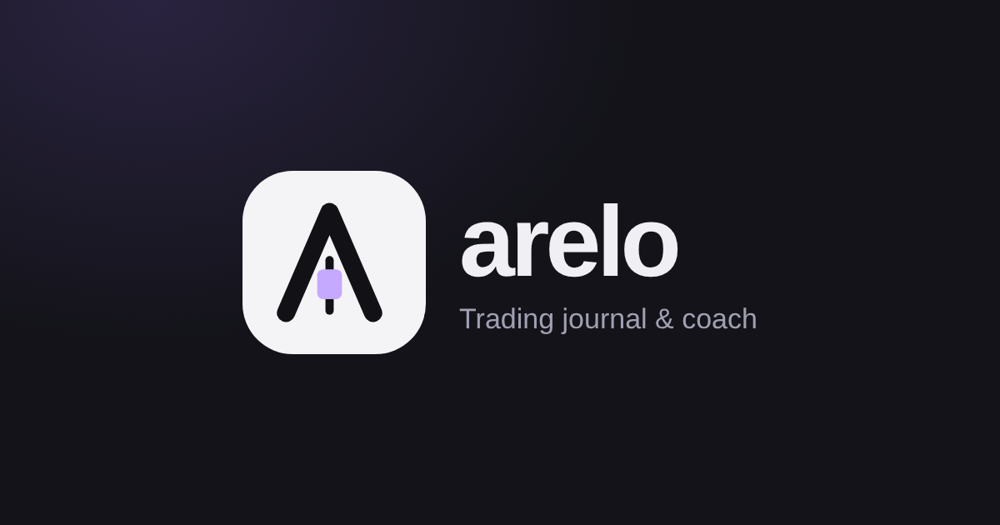

# Arelo

**The discipline journal for traders.** Your trades, your rules and the days behind them in one place: a command center for today, a journal, analysis and live markets, with sleep, mood and habits feeding your coach.

**Open the app:** https://pablo523.github.io/Arete/ · **Landing page:** https://pablo523.github.io/Arete/landing.html · **Try the demo (no account):** https://pablo523.github.io/Arete/?demo=1

## Install on your phone

- **iPhone:** open the link in Safari → Share → *Add to Home Screen*.
- **Android:** open the link in Chrome → *Install app*.

## First start

A short guided intro: language, your name, what you trade, your style and a rule template, your focus, then the app opens on your dashboard with everything set up. The demo link opens a full sample journal (100 days of trades, a prop account, goals and notes) that is never saved.

## Layout

Five sections: **Today** (command bar with today's light, result curve, quick log and check-in), **Journal**, **Analysis**, **Markets** and **More** (practice, league, accounts, tools, routine and the life modules). Today is a tiled desk with a draggable column split, plus a Timeline that tells the day as a story (sleep, plan, every trade with the running result, revenge-window and limit warnings, review). On desktop the journal is a list with a detail pane and a trade map (stop, entry, target, exit and the range while in the trade), browsable with the arrow keys. Analysis reads as a numbered report. Settings → Layout → Airy brings back the classic cards. Tools are split into three tabs: calculators, rules and limits, and import, sharing and reports. Trading mode is calm by default: no confetti on trades. Sidebar on desktop, bottom bar and a + button on the phone.

## What is inside

- **5-second log:** result, symbol, side and rules. Date, time, R, setup, emotion and notes are optional
- **Ask your journal:** plain-language questions like "win rate on Fridays after 15" or "best setup last 30 days", answered instantly with the trades behind the answer
- **Edge score:** profit factor, win/loss ratio, drawdown, win rate, recovery and consistency in one 0–100 score with a radar and your biggest lever
- **Reports:** pivot by setup, market, weekday, hour, hold time, R bucket, mistake and more, plus a scatter plot with any two axes
- **Exit analysis:** MAE/MFE (auto-filled from Replay for crypto), exit efficiency and a stop/target simulator
- **Journal filters and bulk edit:** period, market, setup, side, result, rules, mistake and text search, with summary stats and edit-all
- **Import preview:** CSV, Excel and MT5 HTML reports with a preview of columns, new trades and duplicates before anything is saved
- **MetaTrader 5 auto-import:** the read-only [Arelo Sync robot](mt5/AreloSync.mq5) sends every closed trade to your journal
- **Trust:** [privacy policy](privacy.html), [terms](terms.html), export all data, delete account, and error reports
- **Setup library:** classic setups (ORB, VWAP reclaim, break & retest, London breakout and more) added to your playbook in one tap
- **Notebook:** daily plan, weekly recap, trading plan and after-a-bad-day templates
- **Trade grades A–F, process goals with streaks, fee analysis, a customizable home and an options calculator** (payoff, breakevens, greeks)
- **Share a trade for feedback:** a link mentors and friends can open and comment on
- **Verified badge:** public profiles show how many trades were synced automatically from MetaTrader
- **Risk engine:** Kelly and simulated risk of ruin from your own trades
- **Coach that sees the whole person:** a green, yellow or red light every morning from sleep, mood and yesterday's rule breaks, plus patterns between your life and your results (AI coach in the Claude version)
- **Prop mode:** templates for common challenge types, live chance to pass (simulated from your own trades) and your max risk per trade today
- **Discipline league and mentors:** compete with friends on discipline, never money; mentors see a student's details only when the student allows it
- **Voice log:** say what happened and the trade is filled in
- **Replay:** watch a crypto trade play out candle by candle
- **Price alerts:** crypto alerts, live from Binance, while the app is open
- **What if?:** see what your result would have been if you had followed every rule, stopped after two losses, only taken your best setups and more
- **Practice mode:** a flight simulator for trading. Trade a random historical day candle by candle, with keyboard shortcuts, scored in R
- **Automatic rules:** max trades, pause after a loss, no trades near red news, max loss in R and more, checked on every trade
- **Trading home:** its own tab with a live strip (sessions, next red news), animated result curve in money or R, and a focus mode for market hours
- **Weekly story card:** a 9:16 image of your week in R and discipline, ready for Instagram or TikTok
- **Themes and backgrounds:** Graphite, Bone, Terminal, Amber and Midnight, plus 18 backgrounds
- **Public profile:** share discipline, win rate, average R and your R curve at `?u=your-name`. Never amounts
- Trading journal, playbook, accounts, statistics, Monte Carlo, tilt lock, weekly review, reports, position size calculator
- Markets: TradingView charts and prices, news and the ForexFactory calendar
- Habits, goals, weekly planning, money, training, books and films

## Supabase setup (accounts, sync, leagues, profiles, news)

1. **SQL:** Supabase → *SQL Editor → New query*. New project: paste [`supabase/setup.sql`](supabase/setup.sql) and run. Already ran it before: paste only [`supabase/v15-leagues.sql`](supabase/v15-leagues.sql) and run.
2. **News and calendar proxy:** Supabase → *Edge Functions → Deploy a new function → Via editor*. Name it exactly `feeds`, paste [`supabase/functions/feeds/index.ts`](supabase/functions/feeds/index.ts) and deploy. In the function's settings, turn **off** *Enforce JWT verification* (it only fetches public news).
3. **Trust and MT5 sync (v21):** SQL Editor → paste [`supabase/v21-trust-and-sync.sql`](supabase/v21-trust-and-sync.sql) → Run. Then *Edge Functions → Deploy a new function → Via editor*, name it exactly `ingest`, paste [`supabase/functions/ingest/index.ts`](supabase/functions/ingest/index.ts), deploy, and turn **off** *Enforce JWT verification* (the robot authenticates with the user's sync key).
4. **Trade sharing (v22):** SQL Editor → paste [`supabase/v22-sharing.sql`](supabase/v22-sharing.sql) → Run.
5. **Authentication → URL Configuration:** *Site URL* `https://pablo523.github.io/Arete/`, and the same under *Redirect URLs*.
6. Put the *Project URL* and *publishable* key in [`config.js`](config.js) (already done).

The publishable key is public by design. Row level security makes sure each person only reads and writes their own data. Never share the *service_role / secret* key.

See [LAUNCH.md](LAUNCH.md) for the launch plan.
